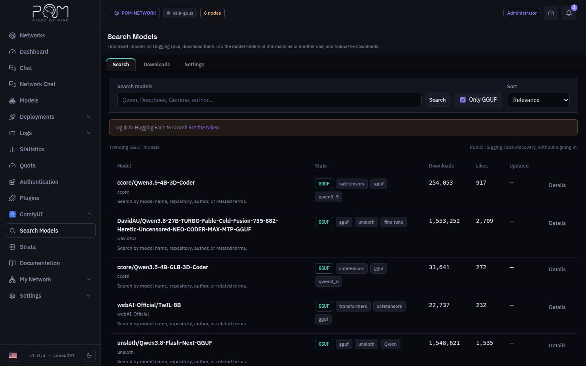
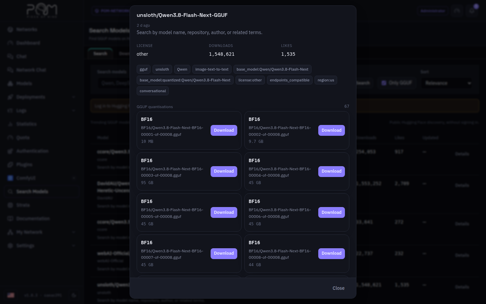
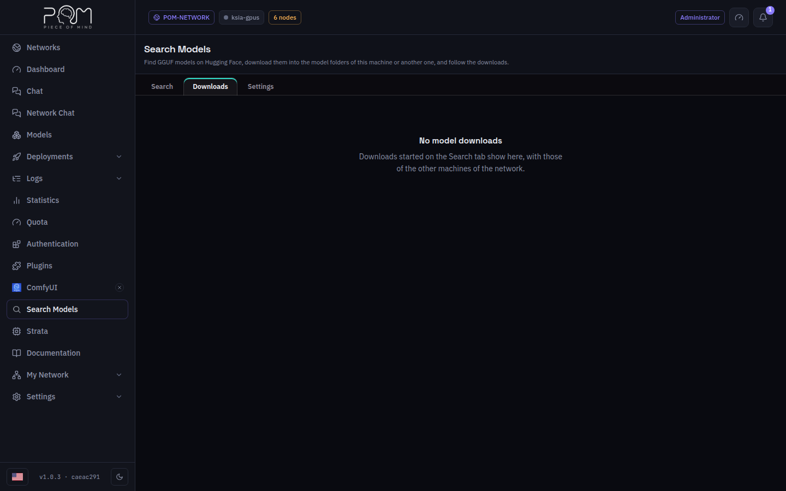
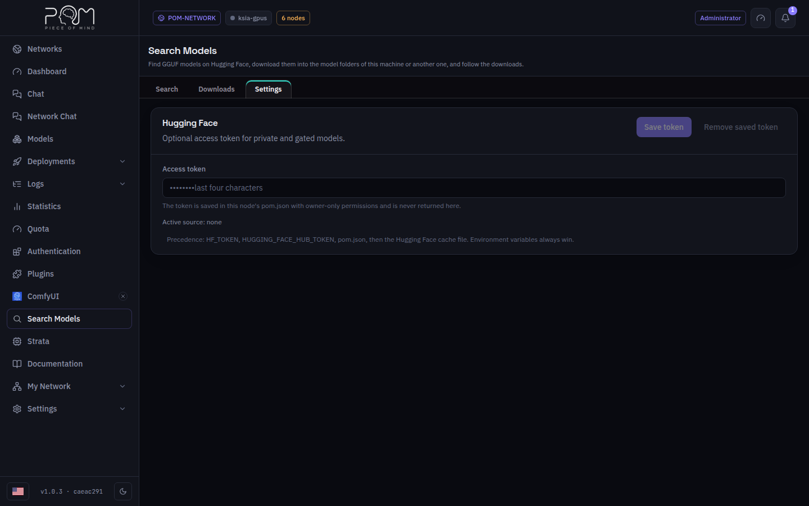

# Search Models

**Search Models** appears in the menu once the Hugging Face plugin is
installed. It has three tabs.

## Search

Type a model name, an author or a repository id; the list updates as you type.
Without a search it shows the trending GGUF models of Hugging Face. **Only
GGUF** keeps the models POM can serve, and **Sort** orders by relevance, by
downloads or by the last update.

Open a model to see its license, tags and every GGUF quantisation with its
size. **Download** on a quantisation opens the download dialog:

- The model downloads to this machine. With more than one POM model folder
  configured, **POM model folder** picks the folder; the available space shown
  is the free space of that folder's disk.
- A model split in several files downloads all of them.
- Vision projectors and MTP drafts of the same repository can be added with
  **Also download**.

A gated or private model needs a token that has access to it (see Settings).

## Downloads

The model downloads of this machine and of the other machines of the network,
with progress, speed and time left. A running download can be cancelled; a
failed or cancelled one can be tried again or dismissed. A finished download
lands in the model folders and shows on the **Models** screen.

## Settings

The machine's Hugging Face access token, for private and gated models. The
field is always empty: the node only shows the last characters of the token it
holds and where it came from. Environment variables (`HF_TOKEN`,
`HUGGING_FACE_HUB_TOKEN`) win over the saved token.

Starting or cancelling downloads and saving the token need a POM that offers
writes to plugin screens; on an older POM the screen says so and only searches.

## Trademarks

Hugging Face is a registered trademark of Hugging Face, Inc. This independent
POM plugin uses the public Hugging Face Hub API and is not affiliated with,
sponsored or endorsed by Hugging Face, Inc. The models keep their own licenses,
shown before each download.
